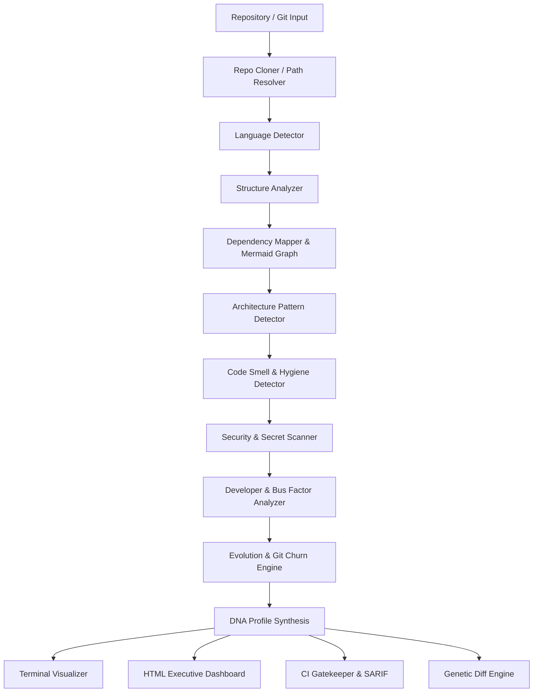

<div align="center">
  
  
  <br/>

  <h1>🧬 CodeDNA</h1>
  <p><b>Software Intelligence System — A Genetic Analyzer for Code</b></p>
  <i>Reverse-engineer any codebase into a DNA profile. Track genetic drift across releases, enforce architectural quality gates in CI/CD, and visualize system evolution.</i>

  <br/>

  [](https://github.com/shenald-dev/codedna/actions)
  [](https://python.org)
  [](https://github.com/shenald-dev/codedna/releases)
  [](LICENSE)
</div>

---

## 📑 Table of Contents
- [✨ What is CodeDNA?](#-what-is-codedna)
- [🚀 Flagship Capabilities](#-flagship-capabilities)
  - [1. ⚙️ Declarative Configuration (`codedna.toml`)](#1-️-declarative-configuration-codednatoml)
  - [2. 🛡️ Architectural Drift Regression Gating (`gate`)](#2-️-architectural-drift-regression-gating-gate)
  - [3. 🧬 Genetic Drift & Architecture Diff Engine (`diff`)](#3--genetic-drift--architecture-diff-engine-diff)
  - [4. 🛡️ CI/CD Quality Gatekeeper & SARIF / PR Markdown (`check`)](#4-️-cicd-quality-gatekeeper--sarif--pr-markdown-check)
  - [5. 🔒 AI & Cloud Security Auditing](#5--ai--cloud-security-auditing)
  - [6. 🎯 Interactive Executive Radar & HTML Dashboard](#6--interactive-executive-radar--html-dashboard)
- [🏗️ Analysis Pipeline](#️-analysis-pipeline)
- [🛠️ Quick Start Guide](#️-quick-start-guide)
- [💻 Comprehensive Usage](#-comprehensive-usage)
  - [Project Scaffolding (`init`)](#project-scaffolding-init)
  - [Analyze a Codebase](#analyze-a-codebase)
  - [Compare Codebases / Branches (`diff`)](#compare-codebases--branches-diff)
  - [Gating Architectural Drift in CI (`gate`)](#gating-architectural-drift-in-ci-gate)
  - [Enforce Quality Gates in CI (`check`)](#enforce-quality-gates-in-ci-check)
  - [GitHub Actions Integration Examples](#github-actions-integration-examples)
- [🧬 Example Output](#-example-output)
- [🤝 Contributing](#-contributing)

---

## ✨ What is CodeDNA?

**CodeDNA** reverse-engineers any codebase and generates a comprehensive "DNA profile". It acts as an automated software architect, traversing tens of thousands of lines of code to distill exactly what a system does, how it is structured, where technical debt hides, and how it is mutating over time.

| Dimension | What It Reveals |
| :--- | :--- |
| 🏗️ **Architecture Pattern** | Monolith, MVC, Layered, Microservices, Plugin, Event-Driven |
| 📊 **Language Distribution** | Files, lines, and percentage share per language (50+ languages supported) |
| 🔗 **Dependency Graph** | Module topology, coupling density, circular dependency cycle detection |
| 🐛 **Code Smells & Hygiene** | God classes, runaway file length, bloated functions, Spaghetti Hub coupling |
| 🔒 **Security Posture** | Hardcoded secrets, AI API keys (OpenAI, Anthropic, HF), command & SQL injection |
| 👥 **Developer Genome** | Active contributors, bus factor risk, primary architects, collaboration |
| 📈 **Evolution Timeline** | Commit growth velocity, churn hotspots, architecture shifts |
| 🧬 **Genetic Drift** | Similarity scoring and mutation delta between branches, commits, or forks |

---

## 🚀 Flagship Capabilities

### 1. ⚙️ Declarative Configuration (`codedna.toml`)
Configure CodeDNA directly within your repository using `codedna.toml` or `pyproject.toml [tool.codedna]`:
- **Path Exclusion Globs:** Cleanly ignore test suites, build outputs, and minified bundles across all analyzers.
- **Secret Whitelisting:** Suppress false positives for intentional test fixtures or mock keys.
- **Custom Smell Thresholds:** Tailor file length, function lines, and method count thresholds to your project's standards.
- **Gate Policies:** Specify default CI quality constraints without repeating CLI flags.

```toml
# codedna.toml
ignore_paths = ["tests/*", "docs/*", "build/*"]
whitelisted_secrets = ["PUBLIC_KEY", "MOCK_TOKEN"]

[gate]
min_health = "Fair"
max_critical_smells = 0
fail_on_secrets = true
fail_on_circular = false
max_drift = 20.0

[smells]
max_file_lines = 650
max_function_lines = 120
god_class_methods = 20
```

### 2. 🛡️ Architectural Drift Regression Gating (`gate`)
Block pull requests that introduce architectural regressions or degrade code quality:
- **Baseline vs. Target:** Compare incoming PR branches against `origin/main` or pre-computed baseline JSON profiles.
- **Zero-Regression Policies:** Fails immediately if codebase health degrades (e.g., Healthy ➔ Critical), circular dependencies are introduced, or genetic drift exceeds allowable tolerance.
- **Exit Codes:** Exits with `0` on clean gates, `1` on regression breach.

```bash
# Evaluate drift between main branch and current working tree
codedna gate origin/main .

# Evaluate drift between two DNA profiles with custom similarity requirements
codedna gate baseline_profile.json pr_profile.json --min-similarity 85.0
```

### 3. 🧬 Genetic Drift & Architecture Diff Engine (`diff`)
Compare two repositories, branches, or pre-generated DNA profiles to measure **architectural drift** and **genetic similarity** (0.0% to 100.0%):
- **Similarity Scoring:** Multi-vector composite evaluation across language distributions, structural size, architectural patterns, dependency graph density, and health ratings.
- **Structural Deltas:** Track added/removed modules, file volume shifts, and language composition changes.
- **Coupling & Cycle Shifts:** Instant alerts if circular dependencies were introduced or resolved.
- **Inline Gating:** Pass `--fail-on-drift` to turn `diff` into a regression gatekeeper.

```bash
# Compare two local repositories
codedna diff ./repo-main ./repo-refactor

# Compare two saved DNA profile snapshots with inline drift gating
codedna diff reports/profile_v1.json reports/profile_v2.json --fail-on-drift
```

### 4. 🛡️ CI/CD Quality Gatekeeper & SARIF / PR Markdown (`check`)
Enforce architectural rules and security standards directly in your build and PR validation pipelines:
- **Policy Gates:** Reject PRs that breach health ratings, introduce hardcoded secrets, or exceed smell thresholds.
- **Native SARIF v2.1.0:** Generates OASIS SARIF output for GitHub Code Scanning tab annotations.
- **PR Review Markdown:** Generates formatted markdown tables (`--format markdown`) ready to post as PR review comments.

```bash
# Validate local repo in CI
codedna check .

# Generate Markdown table for GitHub Actions PR comment
codedna check . --format markdown --output pr-comment.md

# Export SARIF for GitHub Code Scanning
codedna check . --format sarif --output codedna-results.sarif
```

### 5. 🔒 AI & Cloud Security Auditing
Built-in zero-dependency scanning for high-risk vulnerabilities and credentials:
- **AI & Cloud API Tokens:** Detects exposed keys for OpenAI (`sk-...`), Anthropic (`sk-ant-...`), Hugging Face (`hf_...`), Pinecone (`pcsk_...`), AWS, GitHub, Stripe, and Slack.
- **Command Injection:** Flags hazardous `subprocess.*(shell=True)` calls.
- **SQL Injection:** Detects unescaped f-string SQL query executions.

### 6. 🎯 Interactive Executive Radar & HTML Dashboard
The generated HTML dashboard includes:
- **Pure SVG Radar Chart:** Five-dimensional assessment (Health & Hygiene, Security Posture, Modularity & Coupling, Architecture Cohesion, Team Resilience) rendered with zero external CDN dependencies.
- **Interactive Risk Filter:** Client-side instant filtering across code smells, god classes, and security warnings.
- **Print / PDF Ready:** Fully styled `@media print` support for executive architecture reviews.

---

## 🏗️ Analysis Pipeline

CodeDNA executes a modular 10-stage analysis pipeline:



---

## 🛠️ Quick Start Guide

### Installation
```bash
git clone https://github.com/shenald-dev/codedna.git
cd codedna
pip install -e ".[dev]"
```

Verify installation:
```bash
codedna --version
# codedna, version 1.2.0
```

---

## 💻 Comprehensive Usage

### Project Scaffolding (`init`)
Scaffold a starter configuration file in your project:
```bash
codedna init .
```

### Analyze a Codebase
```bash
# Analyze a public GitHub repository
codedna analyze https://github.com/user/project

# Analyze local directory and save all reports (HTML, JSON, Markdown)
codedna analyze . --output reports/

# Headless mode for automated environments
codedna analyze . --no-visualize --output reports/ --format json
```

### Compare Codebases / Branches (`diff`)
```bash
# Terminal comparison
codedna diff ./release-1.0 ./release-2.0

# Generate Markdown diff report
codedna diff ./branch-a ./branch-b --format markdown --output diff-report.md
```

### Gating Architectural Drift in CI (`gate`)
```bash
# Block PR if architecture degrades compared to baseline
codedna gate baseline_dna.json current_dna.json

# Fail if similarity drops below 90% or circular dependencies are added
codedna gate ./main-repo ./pr-repo --min-similarity 90.0
```

### Enforce Quality Gates in CI (`check`)
```bash
# Standard CI check
codedna check .

# Fail on circular dependencies or critical smells
codedna check . --fail-on-circular --max-critical-smells 0
```

### GitHub Actions Integration Examples

#### 1. GitHub Code Scanning (SARIF)
```yaml
name: Architecture & Security Gate
on: [pull_request]

jobs:
  codedna-gate:
    runs-on: ubuntu-latest
    steps:
      - uses: actions/checkout@v4
        with:
          fetch-depth: 100

      - name: Set up Python
        uses: actions/setup-python@v5
        with:
          python-version: '3.11'

      - name: Install CodeDNA
        run: pip install codedna

      - name: Run CodeDNA Gatekeeper & SARIF Export
        run: codedna check . --format sarif --output codedna.sarif

      - name: Upload SARIF to GitHub Code Scanning
        if: always()
        uses: github/codeql-action/upload-sarif@v3
        with:
          sarif_file: codedna.sarif
```

#### 2. Automated PR Review Comment
```yaml
      - name: Generate PR Quality Table
        run: codedna check . --format markdown --output pr-summary.md

      - name: Comment PR
        uses: actions/github-script@v7
        with:
          script: |
            const fs = require('fs');
            const body = fs.readFileSync('pr-summary.md', 'utf8');
            github.rest.issues.createComment({
              issue_number: context.issue.number,
              owner: context.repo.owner,
              repo: context.repo.repo,
              body: body
            });
```

---

## 🧬 Example Output

### Genetic Drift & Mutation Diff
```
┌─────────────────────────── 🧬 Architecture Diff ────────────────────────────┐
│                                                                             │
│  🧬 CodeDNA Genetic Drift & Mutation Diff                                   │
│  Baseline (A): ./v1.1.0                                                     │
│  Target   (B): ./v1.2.0                                                     │
│                                                                             │
│  Genetic Similarity: 96.5% ███████████████████░                             │
│  Mutation Verdict:   Quality & Hygiene Improvement                          │
└─────────────────────────────────────────────────────────────────────────────┘

                      📊 Architectural & Structural Drift                      
┌──────────────────┬──────────────┬──────────────┬────────────────────────────┐
│ Dimension        │ Baseline (A) │ Target (B)   │ Drift / Delta              │
├──────────────────┼──────────────┼──────────────┼────────────────────────────┤
│ Architecture     │ Monolith     │ Monolith     │ Unchanged                  │
│ Health Score     │ Fair         │ Healthy      │ Improved (crit: 0, warn: 0)│
│ Files Count      │ -            │ -            │ +6 files                   │
│ Circular Deps    │ None ✅      │ None ✅      │ Clean                      │
│ Bus Factor       │ -            │ -            │ +1                         │
└──────────────────┴──────────────┴──────────────┴────────────────────────────┘
```

---

## 🤝 Contributing
- 🐛 **Bug reports & ideas:** Open an issue on GitHub.
- 🚀 **Feature additions:** PRs welcome! Ensure all tests pass with `pytest` and code matches `ruff check`.

---
> *Software has DNA too. Decode it with CodeDNA.*
