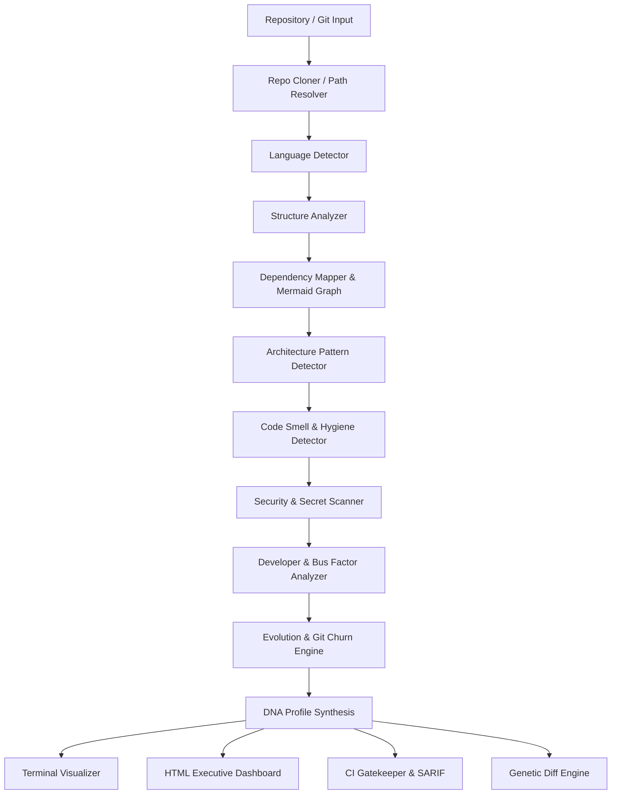

<div align="center">
  
  
  <br/>

  <h1>🧬 CodeDNA</h1>
  <p><b>Software Intelligence System — A Genetic Analyzer for Code</b></p>
  <i>Reverse-engineer any codebase into a DNA profile. Track genetic drift across releases, enforce architectural quality gates in CI/CD, and visualize system evolution.</i>

  <br/>

  [](https://github.com/shenald-dev/codedna/actions)
  [](https://python.org)
  [](https://github.com/shenald-dev/codedna/releases)
  [](LICENSE)
</div>

---

## 📑 Table of Contents
- [✨ What is CodeDNA?](#-what-is-codedna)
- [🚀 Next-Level Capabilities](#-next-level-capabilities)
  - [1. 🧬 Genetic Drift & Architecture Diff Engine (`diff`)](#1--genetic-drift--architecture-diff-engine-diff)
  - [2. 🛡️ CI/CD Quality Gatekeeper & SARIF Support (`check`)](#2-️-cicd-quality-gatekeeper--sarif-support-check)
  - [3. 🎯 Interactive Executive Radar & HTML Dashboard](#3--interactive-executive-radar--html-dashboard)
- [🏗️ Analysis Pipeline](#️-analysis-pipeline)
- [🛠️ Quick Start Guide](#️-quick-start-guide)
- [💻 Comprehensive Usage](#-comprehensive-usage)
  - [Analyze a Codebase](#analyze-a-codebase)
  - [Compare Codebases / Branches (`diff`)](#compare-codebases--branches-diff)
  - [Enforce Quality Gates in CI (`check`)](#enforce-quality-gates-in-ci-check)
  - [GitHub Actions Integration Example](#github-actions-integration-example)
- [🧬 Example Output](#-example-output)
- [🤝 Contributing](#-contributing)

---

## ✨ What is CodeDNA?

**CodeDNA** reverse-engineers any codebase and generates a comprehensive "DNA profile". It acts as an automated software architect, traversing tens of thousands of lines of code to distill exactly what a system does, how it is structured, where technical debt hides, and how it is mutating over time.

| Dimension | What It Reveals |
| :--- | :--- |
| 🏗️ **Architecture Pattern** | Monolith, MVC, Layered, Microservices, Plugin, Event-Driven |
| 📊 **Language Distribution** | Files, lines, and percentage share per language (50+ languages supported) |
| 🔗 **Dependency Graph** | Module topology, coupling density, circular dependency cycle detection |
| 🐛 **Code Smells & Hygiene** | God classes, runaway file length, bloated functions, maintainability risks |
| 🔒 **Security Posture** | Hardcoded secrets, API tokens, RSA/SSH private keys, dependency flags |
| 👥 **Developer Genome** | Active contributors, bus factor risk, primary architects, collaboration |
| 📈 **Evolution Timeline** | Commit growth velocity, churn hotspots, architecture shifts |
| 🧬 **Genetic Drift** | Similarity scoring and mutation delta between branches, commits, or forks |

---

## 🚀 Next-Level Capabilities

### 1. 🧬 Genetic Drift & Architecture Diff Engine (`diff`)
Compare two repositories, branches, or pre-generated DNA profiles to measure **architectural drift** and **genetic similarity** (0.0% to 100.0%):
- **Similarity Scoring:** Multi-vector composite evaluation across language distributions, structural size, architectural patterns, dependency graph density, and health ratings.
- **Structural Deltas:** Track added/removed modules, file volume shifts, and language composition changes.
- **Coupling & Cycle Shifts:** Instant alerts if circular dependencies were introduced or resolved.
- **Mutation Verdicts:** Identifies `"Stable Evolution"`, `"Quality & Hygiene Improvement"`, `"Paradigm Shift / Migration"`, or `"Critical Regression"`.

```bash
# Compare two local repositories
codedna diff ./repo-main ./repo-refactor

# Compare two saved DNA profile snapshots
codedna diff reports/profile_v1.json reports/profile_v2.json --format markdown

# Compare across public GitHub forks
codedna diff https://github.com/org/upstream https://github.com/org/fork
```

### 2. 🛡️ CI/CD Quality Gatekeeper & SARIF Support (`check`)
Enforce architectural rules and security standards directly in your build and PR validation pipelines:
- **Policy Gates:** Reject PRs that breach health ratings, introduce hardcoded secrets, or exceed smell thresholds.
- **Native SARIF v2.1.0:** Generates OASIS SARIF output for GitHub Code Scanning tab annotations.
- **Exit Codes:** Exits with code `0` on clean gates, `1` on policy violations.

```bash
# Validate local repo in CI (fails if health drops below Fair or secrets are found)
codedna check .

# Strict gate: require Healthy status, zero critical smells, and zero circular dependencies
codedna check . --min-health Healthy --max-critical-smells 0 --fail-on-circular

# Export SARIF for GitHub Code Scanning
codedna check . --format sarif --output codedna-results.sarif
```

### 3. 🎯 Interactive Executive Radar & HTML Dashboard
The generated HTML dashboard includes:
- **Pure SVG Radar Chart:** Five-dimensional assessment (Health & Hygiene, Security Posture, Modularity & Coupling, Architecture Cohesion, Team Resilience) rendered with zero external CDN dependencies.
- **Interactive Risk Filter:** Client-side instant filtering across code smells, god classes, and security warnings.
- **Print / PDF Ready:** Fully styled `@media print` support for executive architecture reviews.

---

## 🏗️ Analysis Pipeline

CodeDNA executes a modular 10-stage analysis pipeline:



---

## 🛠️ Quick Start Guide

### Installation
```bash
git clone https://github.com/shenald-dev/codedna.git
cd codedna
pip install -e ".[dev]"
```

Verify installation:
```bash
codedna --version
# codedna, version 1.1.0
```

---

## 💻 Comprehensive Usage

### Analyze a Codebase
```bash
# Analyze a public GitHub repository
codedna analyze https://github.com/user/project

# Analyze local directory and save all reports (HTML, JSON, Markdown)
codedna analyze . --output reports/

# Headless mode for automated environments
codedna analyze . --no-visualize --output reports/ --format json
```

### Compare Codebases / Branches (`diff`)
```bash
# Terminal comparison
codedna diff ./release-1.0 ./release-2.0

# Generate Markdown diff report
codedna diff ./branch-a ./branch-b --format markdown --output diff-report.md
```

### Enforce Quality Gates in CI (`check`)
```bash
# Standard CI check
codedna check .

# Fail on circular dependencies or critical smells
codedna check . --fail-on-circular --max-critical-smells 0
```

### GitHub Actions Integration Example
Add this step to `.github/workflows/ci.yml` to annotate PRs with architectural and security findings:

```yaml
name: Architecture & Security Gate
on: [pull_request]

jobs:
  codedna-gate:
    runs-on: ubuntu-latest
    steps:
      - uses: actions/checkout@v4
        with:
          fetch-depth: 100

      - name: Set up Python
        uses: actions/setup-python@v5
        with:
          python-version: '3.11'

      - name: Install CodeDNA
        run: pip install codedna

      - name: Run CodeDNA Gatekeeper & SARIF Export
        run: codedna check . --min-health Fair --fail-on-secrets --format sarif --output codedna.sarif

      - name: Upload SARIF to GitHub Code Scanning
        if: always()
        uses: github/codeql-action/upload-sarif@v3
        with:
          sarif_file: codedna.sarif
```

---

## 🧬 Example Output

### Genetic Drift & Mutation Diff
```
┌─────────────────────────── 🧬 Architecture Diff ────────────────────────────┐
│                                                                             │
│  🧬 CodeDNA Genetic Drift & Mutation Diff                                   │
│  Baseline (A): ./v1.0.0                                                     │
│  Target   (B): ./v1.1.0                                                     │
│                                                                             │
│  Genetic Similarity: 94.2% ██████████████████░░                             │
│  Mutation Verdict:   Quality & Hygiene Improvement                          │
└─────────────────────────────────────────────────────────────────────────────┘

                      📊 Architectural & Structural Drift                      
┌──────────────────┬──────────────┬──────────────┬────────────────────────────┐
│ Dimension        │ Baseline (A) │ Target (B)   │ Drift / Delta              │
├──────────────────┼──────────────┼──────────────┼────────────────────────────┤
│ Architecture     │ Monolith     │ Monolith     │ Unchanged                  │
│ Health Score     │ Fair         │ Healthy      │ Improved (crit: -1, warn:0)│
│ Files Count      │ -            │ -            │ +4 files                   │
│ Circular Deps    │ Yes ⚠️       │ None ✅      │ Resolved                   │
│ Bus Factor       │ -            │ -            │ +1                         │
└──────────────────┴──────────────┴──────────────┴────────────────────────────┘
```

---

## 🤝 Contributing
- 🐛 **Bug reports & ideas:** Open an issue on GitHub.
- 🚀 **Feature additions:** PRs welcome! Ensure all tests pass with `pytest` and code matches `ruff check`.

---
> *Software has DNA too. Decode it with CodeDNA.*
